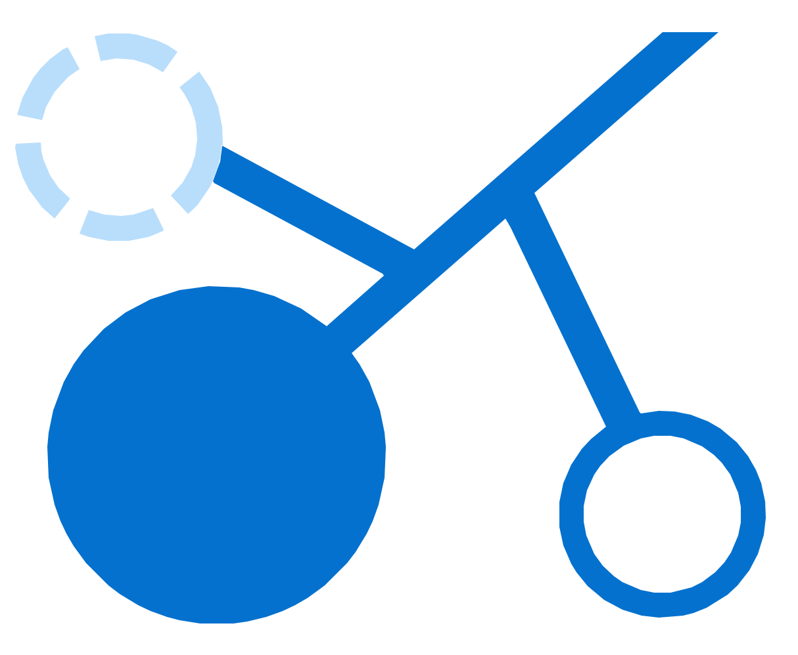

# Mouse Chromatin Atlas — v1

[](https://atlas.epigenomelab.com/) [](https://doi.org/10.1038/s42003-026-09720-w) [](https://www.ncbi.nlm.nih.gov/geo/query/acc.cgi?acc=GSE286329) [](https://atlas.epigenomelab.com/) [](LICENSE) [](site/data/LICENSE.md)

**An interactive open-data resource for single-cell chromatin accessibility across nine mouse tissues.** Explore source-derived UMAPs, annotated cell populations, mm10 marker-accessible genomic regions, ATAC-derived gene activity and precomputed SEACells.

**[Explore the live atlas](https://atlas.epigenomelab.com/)** · [Publication](https://doi.org/10.1038/s42003-026-09720-w) · [GEO GSE286329](https://www.ncbi.nlm.nih.gov/geo/query/acc.cgi?acc=GSE286329) · [Original analysis](https://github.com/OroujiLab/Mouse_Tissues_scATAC)

| Curated atlas cells | Tissues | Named cell types | SEACell groups | Gene profiles |
| :---: | :---: | :---: | :---: | :---: |
| **48,385** | **9** | **28** | **90** | **10** |

The underlying paper reports 51,248 cells study-wide. This release displays the separately validated **48,385-cell curated subset** and does not reconstruct the omitted records.

## What is included

- **Cell atlas:** source UMAP coordinates, tissue/cell-type coloring, filters, composition summaries and CSV export.
- **Accessible regions:** published mm10 marker BED browsing and UCSC navigation.
- **Compare peaks:** descriptive interval overlap between published marker-region lists.
- **Gene activity:** ten precomputed ArchR GeneScoreMatrix profiles, loaded on demand; these are **not RNA expression**.
- **SEACells:** 90 original precomputed groups and their tissue/type membership summaries.
- **Data and reproducibility:** curated CSV/JSON, checksums, scientific provenance and citation metadata.

Peak interval overlap is not a differential-accessibility test; SEACell membership does not establish population purity. Motif and peak-to-gene browsers are not part of v1.

## Run locally

The source CSV `site/data/cells.csv` is stored as six byte-identical parts in `site/data/cell_parts/` solely to accommodate repository transfer limits. Reconstruct it **once** before serving the site; the script checks the source Git blob SHA and size.

```bash
python3 scripts/assemble_cells.py
cd site
python3 -m http.server 8000 --bind 127.0.0.1
```

Open http://127.0.0.1:8000/. All visualization and filtering run in the browser; there is no server-side scientific computation, database or login. `cells.csv` reconstructed locally is not tracked in this Git snapshot.

## Project files

- `site/`: complete HTML/CSS/JavaScript website, citation downloads and lightweight processed data
- `site/data/cell_parts/`: transport-separated original metadata bytes for verified reconstruction
- `scripts/assemble_cells.py`: source-integrity-checked local reconstruction
- `docs/SCIENTIFIC_DATA.md`: field definitions and source provenance
- `docs/RELEASE_NOTES.md`: v1 features, limitations and validation
- `CITATION.cff`: machine-readable citation
- `LICENSE`: original application code MIT license
- `site/data/LICENSE.md`: separately released curated data CC BY 4.0 license

This is a **clean release repository** without the private development repository's history, raw reads, multi-GB analysis objects, unpublished source datasets or private project notes.

## Cite

Nooranikhojasteh A, Tavallaee G, Khuu N, et al. **Chromatin accessibility landscapes define stromal cell identities across tissues.** *Communications Biology* **9**, 480 (2026). https://doi.org/10.1038/s42003-026-09720-w.

[](site/citation.bib) [](site/citation.ris) [](https://pubmed.ncbi.nlm.nih.gov/41735542/)

[Download BibTeX](site/citation.bib) · [Download RIS/EndNote](site/citation.ris) · [PubMed](https://pubmed.ncbi.nlm.nih.gov/41735542/) · [GEO](https://www.ncbi.nlm.nih.gov/geo/query/acc.cgi?acc=GSE286329)

## License

Application software is [MIT](LICENSE); separately released curated `site/data/` files are [CC BY 4.0](site/data/LICENSE.md). Original article, external marker BED sources, third-party components and Epigenome Lab branding retain their respective rights.